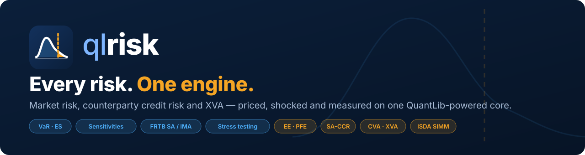

<p align="center">
  
</p>

<h1 align="center">QLRisk v1.3.0</h1>

<p align="center"><strong>Every risk. One engine.</strong><br>
Market risk, counterparty credit risk and XVA — priced, shocked and measured on one QuantLib-powered core.</p>

---

## Copyright Notice

```
Copyright © 2025-2030, All Rights Reserved
Ashutosh Sinha | Email: ajsinha@gmail.com

Legal Notice: This software and its associated documentation are proprietary 
and confidential. Unauthorized copying, distribution, modification, or use is 
strictly prohibited without explicit written permission from the copyright holder.
```

---

## Overview

QLRisk is a professional-grade Python library for **unified trading-book risk analytics**. One product
library, one market-data and scenario layer, and one multi-threaded engine serve three pillars:

| Pillar | What it answers | Key measures |
|--------|-----------------|--------------|
| **Pricing & Sensitivities** | What is it worth, and what moves it? | NPV, Greeks, DV01/PV01, CS01, key-rate and vega buckets |
| **Market Risk** | How much can we lose from market moves? | VaR, Expected Shortfall, Stressed VaR, stress testing, backtesting, FRTB SA / IMA |
| **Counterparty Credit Risk & XVA** | How much can we lose if a counterparty defaults? | CE, EE, EPE, PFE, SA-CCR, CVA/DVA/FVA/KVA/MVA, ISDA SIMM, economic capital |

Every pillar uses the same `price()` call on the same 90+ products, so a swap is valued identically
whether it is being shocked for VaR, simulated for PFE or bumped for FRTB sensitivities.

### Capability Status

| Area | Status |
|------|--------|
| 90+ products across 13 asset classes (79 market-driven pricers, 12 placeholders) | ✅ Available |
| Counterparty credit risk: CE, EE, EEE, PFE, peak and stressed exposure | ✅ Available |
| Credit risk: PD, LGD, EAD, EL, economic capital, RAROC | ✅ Available |
| SA-CCR (Basel III/IV), ISDA SIMM initial margin | ✅ Available |
| XVA: CVA, DVA, FVA, KVA, MVA, ColVA | ✅ Available |
| Monte Carlo path generation (7 stochastic processes) | ✅ Available |
| Risk-factor taxonomy, market-data shocking, factor histories, bump-and-reprice sensitivities | ✅ Available (Phase 1) |
| Market-driven pricers for 59 formerly-placeholder products (bonds, FX/equity/commodity options, CDS, XCCY, ...) | ✅ Available (Phase 1.5) |
| Historical / age-weighted / filtered / Monte Carlo / parametric VaR, Expected Shortfall, Stressed VaR, VaR decomposition | ✅ Available (Phase 2) |
| VaR/ES backtesting, P&L explain, FRTB PLA test, stress-scenario library, reverse stress testing, liquidity VaR | ✅ Available (Phase 3) |
| FRTB SA (SBM delta/vega/curvature, DRC, RRAO), FRTB IMA (LH-ES, IMCC, RFET/SES, IMA DRC), Basel 2.5, BA-CVA | ✅ Available (Phase 4; SA-CVA pending) |
| Unified `RiskEngine`, reporting hierarchy (non-additive VaR roll-up), JSON/CSV reports, limit monitoring, wrong-way risk | ✅ Available (Phase 5) |

The market-risk build-out is described module by module in
[`docs/market_risk/README.md`](docs/market_risk/README.md).

### Key Highlights

- **90+ Financial Products** across 13 asset classes; 79 price off market data (12 complex products still use placeholder pricing — see the roadmap)
- **16 Risk Calculators** with dual Python and QuantLib implementations
- **55+ Domain Models** for trades, portfolios, counterparties, curves, market data and scenarios
- **7 Stochastic Processes** for Monte Carlo simulation (GBM, OU, CIR, Vasicek, Hull-White, Heston, Merton Jump)
- **Multi-threaded Engine** for high-performance parallel computation
- **SA-CCR Implementation** fully compliant with the Basel III/IV regulatory framework
- **XVA Suite** including CVA, DVA, FVA, KVA, MVA, and ColVA calculations
- **Comprehensive SFT Coverage** including Stock Loans, Securities Borrowing, Collateral Swaps, Prime Brokerage
- **Total Return Swaps** for Equity and Bond underlyings with full risk analytics

---

## Table of Contents

1. [Features](#features)
2. [Installation](#installation)
3. [Quick Start](#quick-start)
4. [Project Structure](#project-structure)
5. [Module Reference](#module-reference)
6. [Usage Examples](#usage-examples)
7. [Configuration](#configuration)
8. [Performance](#performance)
9. [Documentation](#documentation)
10. [Version History](#version-history)
11. [License](#license)

---

## Features

### Financial Products (90+ Implementations)

| Category | Count | Products |
|----------|-------|----------|
| **Interest Rate** | 8 | IRS, OIS, FRA, Cap, Floor, Swaption, Basis Swap, IRSLeg |
| **FX** | 6 | Forward, Swap, Option, Barrier Option, NDF, Digital Option |
| **Credit** | 4 | CDS, CDS Index, Total Return Swap, Credit Linked Note |
| **Equity Derivatives** | 6 | Swap, Option, Forward, Variance Swap, Dividend Swap, **Equity TRS** |
| **Commodity** | 3 | Swap, Option, Forward |
| **Cross-Currency** | 3 | XCCY Swap, Basis Swap, MTM Swap |
| **Repo** | 4 | Repo, Reverse Repo, Securities Lending, Buy/Sell Back |
| **SFT** | 7 | Margin Loan, Margin Lending, Collateral Swap, Tri-Party Repo, Prime Brokerage, Securities Borrowing, **Stock Loan** |
| **Money Market** | 7 | CD, BA, Eurodollar, Fed Funds, MMF, Time Deposit, Discount Note |
| **Stocks & ETFs** | 8 | Common Stock, ADR, GDR, Preferred, Warrant, ETF, Mutual Fund, Index Position |
| **Alternatives** | 8 | Crypto (Spot/Future/Perpetual), REIT, Carbon Credit/Future, PE, Hedge Fund |
| **Futures** | 6 | Index, Interest Rate, Bond, VIX, Single Stock, **Commodity Future** |
| **Fixed Income** | 21 | Treasury (Bill/Note/Bond/TIPS), Gilts, Bunds, JGB, OAT, Muni, Agency, Corporate, FRN, Convertible, CP, MTN, MBS, ABS, CDO, CLO, Zero Coupon, **Bond TRS** |

### Risk Calculators (16 Types)

| Category | Calculator | Description |
|----------|------------|-------------|
| **Credit Risk** | `PD` | Probability of Default (Merton, Rating-based, Reduced-form) |
| | `LGD` | Loss Given Default (Workout, Market-implied) |
| | `EAD` | Exposure at Default (Current, Regulatory) |
| | `EL` | Expected Loss = PD × LGD × EAD |
| **Exposure** | `CE` | Current Exposure (MTM, Collateral-adjusted) |
| | `PFE` | Potential Future Exposure (Monte Carlo, Parametric) |
| | `EE` | Expected Exposure Profile |
| | `EEE` | Effective Expected Exposure (Non-decreasing EE) |
| | `PEAK_EXPOSURE` | Maximum Exposure over time horizon |
| | `STRESSED_EXPOSURE` | Stressed market scenarios |
| **Valuation Adjustments** | `CVA` | Credit Valuation Adjustment |
| **Capital & Margin** | `EC` | Economic Capital (Vasicek, Gordy, Basel IRB) |
| | `RAROC` | Risk-Adjusted Return on Capital |
| | `IM` | Initial Margin (ISDA SIMM) |

### Market Risk Measures (✅ = available, others planned)

| Category | Measure | Description |
|----------|---------|-------------|
| **Sensitivities** ✅ | `DELTA`, `GAMMA`, `VEGA`, `THETA`, `CROSS_GAMMA` | Bump-and-reprice first/second-order, volatility and time sensitivities |
| ✅ | `DV01`, `CS01`, key-rate ladders | Rate, credit-spread and key-rate sensitivities on native pillars or FRTB vertices |
| **VaR** ✅ | Historical | Full revaluation or Taylor; equal, age-weighted (BRW) or filtered (EWMA) scenarios |
| ✅ | Parametric | Delta-normal (sample or EWMA covariance); Cornish-Fisher via `parametric_var` |
| ✅ | Monte Carlo | Normal / Student-t scenarios from the return covariance |
| ✅ | Stressed VaR | VaR on the 250-day window that maximises portfolio VaR |
| **Tail Risk** ✅ | Expected Shortfall | ES at 97.5% or any confidence, historical or parametric |
| **Attribution** ✅ | Component / incremental / standalone | Euler contributions by trade, desk or any grouping |
| **Validation** ✅ | Backtesting | Kupiec, Christoffersen, Basel traffic light / multiplier; Acerbi-Székely ES (Z1, Z2) |
| ✅ | P&L explain / PLA | Theta + per-factor Taylor + unexplained; FRTB Spearman / KS zones |
| **Stress** ✅ | Library / reverse | 9 historical crises (1987–2023); minimum-Mahalanobis reverse stress |
| **Regulatory** ✅ | FRTB SA | Sensitivities-based method (delta, vega, curvature, 3 correlation scenarios), DRC, RRAO |
| ✅ | FRTB IMA | Liquidity-horizon ES, stress calibration, IMCC, RFET, SES, IMA DRC, capital |
| ✅ | Basel 2.5 / BA-CVA | VaR + SVaR with multiplier; BA-CVA reduced and full (SA-CVA planned) |

### Domain Models (55+ Types)

| Module | Models |
|--------|--------|
| **Trade** | Trade, TradeType, TradeStatus |
| **Portfolio** | Portfolio, PortfolioSnapshot, PortfolioSummary |
| **Counterparty** | Counterparty, NettingSet, CollateralAgreement |
| **Curve** | YieldCurve, CreditCurve, VolatilitySurface |
| **Market Data** | MarketData, MarketDataSnapshot, Quote |
| **Scenario** | Scenario, ScenarioSet, MonteCarloScenarioSet |
| **Exposure** | ExposureProfile, ExposureResult, SACCRResult |
| **Rating** | CreditRating, RatingHistory, TransitionMatrix |

---

## Installation

### Prerequisites

- Python 3.9 or higher
- pip package manager

### Install

```bash
# From PyPI (once published)
pip install qlrisk

# From source (editable, with dev tools)
git clone https://github.com/ajsinha/qlrisk.git
cd qlrisk
pip install -e ".[dev]"
```

This installs the dependencies (numpy, scipy, QuantLib) automatically. They are also listed in
`requirements.txt` (runtime) and `requirements-dev.txt` (adds pytest, build, twine):

```bash
pip install -r requirements.txt        # runtime only
pip install -r requirements-dev.txt    # development
```

### Run the Tests

```bash
pytest                                  # 151 tests, incl. closed-form checks and every guide example
```

### Build a Local Wheel

```bash
pip install build
python -m build --wheel          # -> dist/qlrisk-1.3.0-py3-none-any.whl

# then, in any other project / virtualenv:
pip install /path/to/qlrisk/dist/qlrisk-1.3.0-py3-none-any.whl
```

### Running the Demo

```bash
qlrisk --quick        # Quick demo
qlrisk                # Full demonstration
qlrisk --benchmark    # Performance benchmarks
qlrisk --stress       # Stress testing
qlrisk --market-risk  # Market risk report: VaR, ES, SVaR, stress, backtest, limits
qlrisk --frtb         # FRTB SA capital breakdown

# Or run as a module
python -m qlrisk --quick
```

---

## Quick Start

### Every Risk in One Call

```python
from qlrisk.demos import demo_book
from qlrisk.engine import RiskEngine
from qlrisk.reporting import RiskLimit

book, md, history, tree, frtb_maps = demo_book()
report = RiskEngine(reporting_currency="USD").run(
    book, md, history, hierarchy=tree, frtb=frtb_maps,
    limits=[RiskLimit("Firm 1d VaR", "var.1d", 500_000)])
print(report)                                   # PV, DV01/CS01/delta/vega, VaR, ES, SVaR, stress, FRTB SA, exposure
print(report.results["limits"][0])
```

### Basic Risk Calculation

```python
from qlrisk.engine import CCREngine
from qlrisk.calculator import CalculatorType

with CCREngine() as engine:
    # Calculate probability of default
    pd_result = engine.calculate(
        CalculatorType.PD,
        {'credit_rating': 'BBB'},
        calculator_config={'model': 'transition_matrix'},
    )
    print(f"PD: {pd_result.value:.4%}")
```

### Sensitivities (DV01, Delta, Vega, ...)

```python
from datetime import date
from qlrisk.data import create_sample_market_data
from qlrisk.products.base import Currency
from qlrisk.products.python import InterestRateSwap
from qlrisk.sensitivities import SensitivityEngine, FRTB_GIRR_VERTICES

md = create_sample_market_data(date(2026, 10, 9))
swap = InterestRateSwap("IRS-1", md.valuation_date, md.valuation_date, date(2031, 10, 9),
                        10_000_000, Currency.USD, "CP-1", fixed_rate=0.044)

result = SensitivityEngine().compute([swap], md, reporting_currency="USD")
print(result.aggregate(("risk_class", "measure")))                 # DV01 by risk class
print(result.ladder("forward_curves", "SOFR", vertices=FRTB_GIRR_VERTICES))
```

### VaR and Expected Shortfall

```python
from qlrisk.data import MarketHistoryGenerator
from qlrisk.engine import MarketRiskEngine
from qlrisk.scenarios import historical_scenarios

history = MarketHistoryGenerator(seed=7).generate(md, num_days=750, stress_start=300, stress_days=60)
engine = MarketRiskEngine(reporting_currency="USD")
pnl = engine.scenario_pnl([swap], md, historical_scenarios(history, lookback=250))
print(pnl.var(0.99), pnl.es(0.975))
print(engine.stressed_var([swap], md, history, horizon_days=10))
```

### Shock Market Data

```python
from qlrisk.riskfactors import apply_shocks, curve_shocks, twist, ShockType

eq_crash  = apply_shocks(md, {"EQ.SPX": -0.20}, ShockType.RELATIVE)
steepener = apply_shocks(md, curve_shocks(md, "forward_curves", "SOFR", twist(-0.0025, 0.0025)))
print(swap.price(steepener).npv - swap.price(md).npv)
```

### Generate Test Data

```python
from qlrisk.data import DataGenerator, create_test_dataset

# Quick dataset
dataset = create_test_dataset(num_trades=1000)
print(f"Generated {dataset['summary']['num_trades']} trades")
```

### Path Generation

```python
from qlrisk.mathlib import MathFactory, PathGenerationParams, ProcessType

factory = MathFactory.get_instance()
path_gen = factory.create_path_generator(implementation='python')

params = PathGenerationParams(
    initial_value=100.0,
    drift=0.05,
    volatility=0.20,
    maturity=1.0,
    num_steps=252,
    num_paths=10000
)

result = path_gen.generate_paths(params, ProcessType.GBM)
print(f"Final mean: {result.paths[:, -1].mean():.2f}")
```

---

## Project Structure

```
qlrisk/
├── __init__.py              # Package initialization (v1.3.0)
├── __main__.py              # Entry point for python -m
├── main.py                  # Main demonstration script
├── core/                    # Core utilities (9 files)
├── calculator/              # Risk calculators (29 files)
│   ├── python/              # Python implementations
│   └── qlib/                # QuantLib implementations
├── products/                # Financial products (90+ files)
│   ├── python/              # 80 Python products
│   └── qlib/                # QuantLib products
├── models/                  # Domain models (14 files)
├── mathlib/                 # Mathematical library (6 files)
├── engine/                  # RiskEngine, MarketRiskEngine, CCREngine
├── riskfactors/             # Risk-factor keys, shocks, histories (5 files)
├── sensitivities/           # Bump-and-reprice sensitivities and ladders (5 files)
├── scenarios/               # Historical, filtered, Monte Carlo, hypothetical scenarios; stress windows
├── pnl/                     # Full-revaluation and Taylor P&L, VaR/ES decomposition, P&L explain, PLA
├── backtesting/             # VaR (Kupiec, Christoffersen, traffic light) and ES backtests
├── regulatory/              # FRTB SA / IMA, Basel 2.5, BA-CVA, SA-CCR (re-export)
├── reporting/               # Risk reports, hierarchy roll-ups, limit monitoring
├── demos.py                 # Demo book used by --market-risk / --frtb and the guides
├── data/                    # Data generation (2 files)
└── config/                  # Configuration
```

At the repository root:

```
docs/                        # Documentation (140+ files)
├── guides/                  # User guides with tested examples (start here)
├── market_risk/             # Market-risk roadmap and methodology
├── calculators/ models/ products/ metrics/   # Reference
└── architecture.md, quickstart.md, mathematical_formulas.md, saccr.md
tests/                       # pytest suite (incl. every guide example)
assets/branding/             # Logo, favicon, hero banner
dist/                        # Built wheel
```

All five roadmap phases are delivered; remaining work (SA-CVA, 12 complex products) is tracked in the
[roadmap](docs/market_risk/README.md).

Brand assets (logo, favicon, hero banner) live in [`assets/branding/`](assets/branding/BRAND.md).

---

## Configuration

Configuration file: `config/application.properties`

```properties
engine.max_workers=8
engine.default_implementation=python
montecarlo.num_paths=10000
calculator.confidence_level=0.99
logging.level=INFO
```

---

## Performance

| Operation | Python | QuantLib | Speedup |
|-----------|--------|----------|---------|
| PD Calculation | 0.05ms | 0.02ms | 2.5x |
| CVA (100 points) | 2.5ms | 0.8ms | 3.1x |
| PFE Monte Carlo | 150ms | 45ms | 3.3x |

---

## Documentation

**Start with the [user guides](docs/guides/README.md)**: installation, first portfolio, market data,
shocks and scenarios, historical data, pricing, sensitivity reports, counterparty exposure. Every example in
them is executed by the test suite.

See the `docs/` directory for comprehensive documentation:

- `docs/architecture.md` - System architecture
- `docs/market_risk/` - Market-risk roadmap, [risk factors](docs/market_risk/risk_factors.md), [sensitivities](docs/market_risk/sensitivities.md), [pricers](docs/market_risk/pricers.md), [VaR / ES](docs/market_risk/var_es.md), [validation & stress](docs/market_risk/validation.md), [regulatory capital](docs/market_risk/frtb.md)
- `docs/quickstart.md` - Getting started guide
- `docs/mathematical_formulas.md` - Mathematical reference
- `docs/calculators/` - Calculator documentation
- `docs/products/` - Product documentation (80+ files)

---

## Version History

| Version | Date | Changes |
|---------|------|---------|
| *Unreleased* | Oct 2026 | Phase 5: `RiskEngine` (all measures in one call, from_config), `reporting` (hierarchy, RiskReport JSON/CSV, limits), wrong-way risk, `--market-risk` / `--frtb` CLI, `marketrisk.*` config, market-risk `LimitType`s. Phase 4: `regulatory` — FRTB SA (SBM, DRC, RRAO), FRTB IMA (LH-ES, IMCC, RFET, SES, IMA DRC), Basel 2.5, BA-CVA. Phase 3: `backtesting` (Kupiec, Christoffersen, traffic light, Acerbi-Székely), P&L explain, FRTB PLA test, stress library, reverse stress, liquidity VaR, `MarketRiskEngine.backtest / stress_test / reverse_stress / explain`; bonds exclude coupons before the effective date. Phase 2: `scenarios`, `pnl`, `MarketRiskEngine` — historical / filtered / age-weighted / Monte Carlo / parametric VaR, ES, Stressed VaR, Euler and incremental decomposition, VAR / EXPECTED_SHORTFALL calculator types. Market-risk Phase 1 + 1.5: `riskfactors`, `sensitivities`, synthetic market history, test suite, analytic pricers for 59 products (`commodity_prices` added to MarketData); user guides with tested examples; SA-CCR supervisory duration / option delta added (IR product SA-CCR previously raised AttributeError); curve interpolation fix across 87 products (PVs of curve-dependent products change); FX forward/swap PV currency fix; requirements files |
| **v1.3.0** | Dec 2025 | Documentation overhaul, import fixes, version sync |
| v1.2.0 | Dec 2025 | XVA calculators, SA-CCR, 80 products |
| v1.1.0 | Dec 2025 | Expanded products, documentation |
| v1.0.0 | Dec 2025 | Initial release |

---

## License

```
Copyright © 2025-2030, All Rights Reserved
Ashutosh Sinha | Email: ajsinha@gmail.com

PROPRIETARY AND CONFIDENTIAL
```

---

*QLRisk v1.3.0 — Every risk. One engine. | Copyright © 2025-2030 Ashutosh Sinha*
